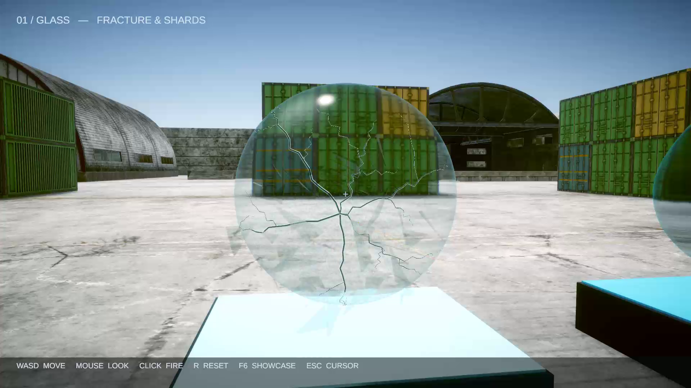
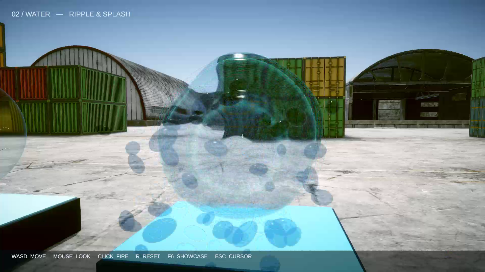

# W06 흔적 - GLASS / WATER

**황승경_202202842**

W06 / 3D 디지털 이펙트 / 2026.10.26

## 흔적 
GLASS / WATER

황승경_202202842 
유리는 금이 남고, 물은 충격을 흘려보낸다.

선택한 두 구슬이 같은 총알에 서로 다르게 반응하도록 제작했다. 유리는 표면의 긴 균열과 각진 파편으로, 물은 계속 변하는 실루엣과 피탄 파동·물방울로 재질의 성질을 구분한다.

| 대상 | 피탄 반응 | 표현 의도 |
| --- | --- | --- |
| 유리 | 구면을 따라 뻗는 긴 금 회전하며 튀는 유리 파편 | 짧은 충격 뒤에도 흔적을 남기는 단단하고 깨지기 쉬운 재질. |
| 물 | 평상시 잔잔한 흔들림 피탄 파동과 물방울 | 변형과 회복이 이어지는 액체의 부드러운 반응. |

### 교수자 맵 안의 새 작업 구역

W06 산업단지 배경을 유지하고 컨테이너 앞마당 (-75, 0, 310)에 두 구슬을 배치했다. 수업 시연 위치 (-125, 0, 315)에서 동쪽으로 약 50 m 떨어져 있다. 원본 배경의 지형·건물·소품·조명은 그대로 사용하고 과제 표적만 교체했다.

구슬 지름은 2.25 m이고 두 중심은 5.2 m 떨어져 있다. 옅은 유리와 청색 물, 아래 받침대의 GLASS / WATER 표기로 대상을 구분한다.

> 현재 구슬 표면은 URP HLSL 셰이더, 유리 균열은 구면 메시, 파편·물방울은 Particle System으로 구현했다. 기존 Shader Graph·VFX Graph 애셋과 새 구슬 구현을 구분해 기록한다.

### 프로젝트 열기

Unity Hub에서 프로젝트 폴더를 추가하고 Unity 6000.3.23f1로 연다. Assets > W06_HW > W06_HW 씬에서 Play하면 소총이 자동 장착된다.

---

01 / GLASS

## 표면을 타고 뻗는 금

맞은 곳에서 긴 균열이 갈라지고, 얇고 각진 조각이 바깥쪽으로 튄다.

총알이 처음 들어온 표면을 역방향 레이로 찾는다. 그 점에서 구면을 따라 경로를 만들고 작은 방향 변화를 더해 꺾인 금을 구성한다. 어두운 중심과 밝은 가장자리를 가진 가는 메시를 구 표면 바로 위에 붙인다.

| 항목 | 설정값 | 선택한 이유·효과 |
| --- | --- | --- |
| 유리 표면색 | RGB (0.64, 0.88, 0.96) Tint opacity 0.23 | 배경을 비추면서 옅은 청색 두께감을 유지한다. |
| 매끄러움 / 굴절 | Smoothness 0.96 Refraction 0.025 | 매끈한 반사와 배경 굴절로 유리를 구분한다. |
| 주 균열 | 6개 방향 / 경로당 22구간 긴 3개 + 짧은 3개 | 한 점에서 길이가 서로 다른 금이 뻗는다. |
| 긴 균열의 각도 | 1.55-1.93 rad 약 89-111도 | 구슬의 정면을 넘어 곡면을 타는 긴 금을 만든다. |
| 가지 균열 | 주 균열마다 2개 길이 0.25-0.63 rad | 규칙적인 방사형 모양을 깨고 파손의 세부를 더한다. |
| 균열 폭 / 부착 반경 | 기준 폭 0.0048 로컬 반경 0.5035 | 반경 0.5인 구 바로 위에 붙여 겹침을 피하고 끝은 가늘게 한다. |
| 흔적 보관 | 최대 5회 피탄 흔적 R로 초기화 | 여러 번 쏜 결과를 남기면서 메시 수의 증가를 제한한다. |
| 파편 개수 / 형상 | 36개 얇은 삼각기둥 메시 | 둥근 점 대신 각진 유리 조각의 실루엣을 만든다. |
| 파편 굴절 재질 | Opacity 0.48 Refraction 0.003 | 파편이 배경을 비추면서도 실루엣은 읽히도록 조정했다. |
| 파편 크기 / 속도 | 기준 크기 0.055-0.23 초기 속도 2.3-5.4 | 크고 작은 파편이 빠르게 퍼지도록 한다. |
| 파편 수명 / 중력 | 0.75-1.50초 Gravity Modifier 0.85 | 표면 바깥쪽으로 튄 뒤 낙하하며 정리된다. |

### 지속되는 흔적과 짧은 움직임

균열은 사라지지 않는 표면 반응이고 파편은 짧은 입자 반응이다. 파편에도 배경을 읽는 굴절 재질과 무작위 크기·회전, 수명 후반의 투명도 감소를 적용했다. 구슬 전체를 부수는 대신 구의 형태를 유지해 누적되는 금을 비교할 수 있게 했다.

---

02 / WATER

## 흔들린 뒤 다시 잔잔하게

평소에는 천천히 울렁이고, 맞은 순간 큰 파동과 물방울이 함께 생긴다.

서로 다른 방향·속도의 파형을 합쳐 기본 표면을 움직인다. 피탄 이벤트는 셰이더에 시간과 충돌 방향을 전달한다. 맞은 곳에서 각거리로 퍼지는 파동에 전체 흔들림을 더하고, 시간이 지날수록 강도를 줄인다.

| 항목 | 설정값 | 선택한 이유·효과 |
| --- | --- | --- |
| 물 표면색 | RGB (0.035, 0.48, 0.73) Tint opacity 0.46 | 유리보다 짙은 청색으로 액체의 부피를 구분한다. |
| 매끄러움 / 굴절 | Smoothness 0.96 Refraction 0.035 | 변하는 표면의 반사와 굴절을 드러낸다. |
| Idle Wobble | 0.035 | 피탄 전에도 물 구슬의 실루엣이 작게 움직인다. |
| 평상시 파형 | 시간 계수 1.85 / -1.45 혼합 비중 0.56 / 0.44 | 한 방향으로만 진동하지 않도록 두 파형을 합친다. |
| 충격 전달 | ImpactTime / ImpactPoint ImpactStrength 1 | 마지막 피탄 시간과 로컬 충돌 방향을 표면 반응에 사용한다. |
| 충격 파동 | 각거리 계수 12 시간 계수 13.5 | 맞은 곳에서 곡면을 따라 밝은 파동과 변형이 퍼진다. |
| 변형 배율 / 감쇠 | 0.105 exp(-경과시간 x 1.16) | 큰 출렁임 뒤 2초에는 강도 약 10%로 감소한다. |
| 구 표면 메시 | 경도 96 x 위도 64 | 정점 변형으로 변하는 윤곽을 부드럽게 표현한다. |
| 물방울 개수 / 형상 | 44개 둥근 방울 메시 | 유리 파편과 다른 매끈한 실루엣을 만든다. |
| 물방울 굴절 재질 | Opacity 0.72 Refraction 0.004 | 물방울의 둥근 윤곽과 배경 굴절이 함께 보이게 한다. |
| 물방울 크기 / 속도 | 기준 크기 0.07-0.20 초기 속도 2.3-4.7 | 일부 큰 방울을 섞어 물이 흩어지는 양감을 준다. |
| 수명 / 중력 | 0.75-1.50초 Gravity Modifier 0.70 | 유리보다 가볍게 흩어진 뒤 낙하한다. |

### 반응의 범위

물의 움직임은 실시간 유체 시뮬레이션이 아닌 셰이더 정점 변형이다. 충돌 판정은 안정적인 SphereCollider로 유지한다. 연속 피탄은 마지막 충격 시점과 방향으로 파동을 다시 시작하고, R은 피탄 흔들림을 지우되 평상시 움직임은 유지한다.

---

03 / CONNECTION + INPUT

## 총알에서 표면 반응까지

수업의 Trigger와 Actor를 유지하고 Inspector 이벤트로 새 효과를 연결했다.

| 단계 | 연결 | 역할 |
| --- | --- | --- |
| 1. 사격 | Single 모드 Bullet 태그 총알 | 왼쪽 클릭 한 번에 총알 한 발이 이동한다. |
| 2. 감지·표면 확인 | Trigger_OnTriggerTag W06OrbHitGate.TryHit | 총알 태그와 본체 표면을 지나는 경로를 확인한 뒤 OnConfirmedHit 이벤트를 실행한다. |
| 3. 표면 반응 | W06ReactiveOrb ReceiveHit | 유리는 균열 메시를 추가하고 물은 충격 시간·방향을 셰이더에 전달한다. |
| 4. 입자 반응 | Actor_Instantiate InstantiateAtObject | 표면의 법선에 맞춰 Glass 또는 Water 피탄 프리팹을 생성한다. |
| 5. 정리 | 입자 수명 + 액터 수명 | 입자는 점차 사라지고 피탄 프리팹은 3초 뒤 정리된다. |

### 안정적인 사격과 표시

| 항목 | 설정값 | 역할 |
| --- | --- | --- |
| 총 / 총알 | Single / 속도 32 모드 전환 끔 | 제공 Auto의 누름·Update 중복 발사를 피한다. |
| 물리 간격 | 0.01초 | 빠른 총알의 감지 간격을 줄이며 프로젝트에 영구 저장한다. |
| 본체 / 감지 반경 | 로컬 0.5 / 0.67 | 감지 영역만 스치는 빗맞음은 본체 레이 검사에서 제외한다. |
| Trail | 0.22초 / 폭 0.035 | 총알이 움직인 자리를 짧고 가는 빛으로 표시한다. |
| 카메라 | Opaque Texture 켬 Depth Texture 켬 | 불투명 배경을 읽어 구슬의 굴절에 사용한다. |

### 조작

WASD 이동 / 마우스 조준 / 왼쪽 클릭 사격. R로 구슬의 흔적과 충격 반응을 초기화한다. F6으로 두 구슬의 자동 시연을 시작하거나 끝내고, Esc로 커서를 해제하거나 직접 조작으로 돌아온다.

### 편집할 위치

Assets/W06_HW의 Shaders에서 표면, Scripts에서 명중·균열·입자 반응을 편집한다. 
Editor/W06OrbSceneBuilder.cs는 Materials·Prefabs·Meshes와 씬 구성을 저장한다.

---

04 / VERIFICATION + DELIVERY

## 확인한 결과와 제출 자료

### 제작에서 선택한 방법

| 문제·의도 | 선택한 방법 | 이유 |
| --- | --- | --- |
| 입자가 하얀 덩어리처럼 보임 | 굴절 입자 전용 셰이더 | 배경을 비추는 투명한 조각·방울로 재질감을 조정했다. |
| 잔잔함과 피탄을 구분 | 기본 파형 + 감쇠하는 충격 파형 | 평소의 울렁임보다 피탄 순간의 반응을 크게 만든다. |
| 넓은 감지 영역의 빗맞음 | 본체 콜라이더 레이 검사 | 총알의 경로가 실제 구에 닿을 때만 피탄 이벤트를 보낸다. |

### 검증 상태: 유리·물 구슬 제작 및 실행 검증 완료

자동 시연과 실제 마우스 클릭은 서로 다른 경로다. 아래 결과는 두 구슬 버전에 대해 확인한 범위만 기록한다. 확인일: 2026.10.26

| 확인 항목 | 상태 | 증거·후속 확인 |
| --- | --- | --- |
| Game 뷰 클릭 사격 | 통과 | 별도 입력 검사: Single 발사 4회, 유리 3회·물 1회 명중. 발사 메서드 직접 호출 없이 실제 클릭으로 확인. |
| 구슬 표면과 파편 | 통과 | 최종 시연에서 긴 구면 균열, 투명 유리 파편, 물 표면의 변형·감쇠 파동, 굴절 물방울을 확인. |
| 빗맞음·초기화 | 통과 | 본체 밖·감지 영역 안으로 보낸 물리 총알 2발의 추가 명중 0. Input System의 R 키 이벤트로 균열·충격 초기화 확인. |
| 원본 배경·컴파일 | 통과 | 배경 14개 루트·3,113개 Transform, 변경 0. 누락 스크립트 0, 구슬 셰이더 컴파일 오류 없음. |
| Unity Recorder | 완료 | 두 구슬 각 5회, 총 10회 명중. 754프레임, Completed / demoComplete=true. |

영상: Deliverables/W06_202202842.mp4 / H.264, 1920x1080, 30fps, 25.1초 / 25,791,103 bytes 
Git 제출: 유리·물 구슬 버전 / W06 브랜치 / https://github.com/ikayaki1202/VFX_202202842/tree/W06

### 제출 경로와 출처

검증 범위: 클릭 검증의 조준은 잠시 고정했고 R은 Input System 큐 이벤트로 확인했다. 에디터 도구 QuickInstall 문자열 예외 1건은 게임 피탄 예외와 구분했다. 첫 클릭 화면의 입자는 중간 재질이며 최종 외형은 이 매뉴얼의 시연 캡처와 새 MP4가 기준이다. 자세한 기록은 verification.json에 남겼다.

프로젝트는 VFX_202202842 저장소의 W06 브랜치에 제출한다. 영상과 이 매뉴얼은 LMS에 별도로 업로드한다. 제출기한은 2026년 10월 31일(토)이다. 기존 direct_fire 폴더의 금속·목재·콘크리트 화면은 이전 버전의 기록이다.

제작 기반: 교수자의 KNU_VFX_2026Q3 수업 저장소. 제공 모델·텍스처·프레임워크의 권리는 원저작자에게 있다. 원본 산업단지 씬 파일과 맵 애셋은 변경하지 않았다.

- [6주차 수업자료](https://docs.google.com/presentation/d/1MXeQCkpXs_B87I_nM_-FYUNbqKFaTL3E2YQaEtwUuCs)
- [5주차 참고자료](https://docs.google.com/presentation/d/1y9TF_Vt_eOuZOgNpOAbq7n4n-BkedC4VmFDR3bX-71k)
- [교수자 원본 저장소](https://github.com/EDU-KNU-VFX-2026Q3/KNU_VFX_2026Q3)
