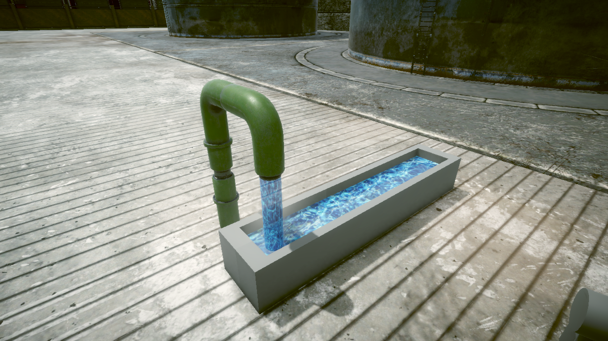

# 04주차 과제 제출

**황승경_202202842** · VFX 수업 · `W04` 브랜치

파이프에서 물이 흘러내리고, 수조의 수면이 움직이는 Unity 물 이펙트 작업입니다.

## 프로젝트 열기

1. 이 저장소의 `W04` 브랜치를 내려받습니다.
2. Unity Hub에서 내려받은 폴더를 추가하고 **Unity 6000.3.23f1**로 엽니다.
3. 처음 열 때 에셋 가져오기가 끝날 때까지 기다립니다.
4. `Assets/W04_HW/W04_HW.unity` 씬을 엽니다.
5. 재생 버튼을 눌러 물줄기와 수면의 움직임을 확인합니다.

## 작업 내용

- 파이프 아래의 흰색 원기둥에 흐르는 물 재질을 적용하고 출구와 수면 사이에 맞췄습니다.
- 수조 안의 흰색 평면에 움직이는 물 표면 재질을 적용했습니다.
- 파이프 주변의 사각형에는 가장자리가 부드러운 물안개를 적용했습니다.
- 수조와 파이프의 형태 및 수업용 환경은 유지했습니다.

## 주요 파일

| 위치 | 내용 |
| --- | --- |
| `Assets/W04_HW/W04_HW.unity` | 제출용 씬 |
| `Assets/W04_IntroductionToShader/Water_Ready/` | 이번 작업의 물줄기·수면·물안개 재질 |
| `Assets/W04_IntroductionToShader/W04_IntroductionToShader_Start.unity` | 같은 효과를 적용한 수업 시작 씬 |

씬의 `W04.Environment > Pipe` 아래에서 `Water_Fall`, `Water_Puddle`, `Water_Steam` 오브젝트를 확인할 수 있습니다. 물줄기 투명도는 `Mat_Pipe_Flow`의 `Water Alpha` 값으로 조절할 수 있습니다.

## 수업 자료

[KNU VFX 2026Q3 수업 저장소](https://github.com/EDU-KNU-VFX-2026Q3/KNU_VFX_2026Q3)의 W04 프로젝트를 기반으로 작업했습니다. 환경 모델과 기존 셰이더 등 수업 제공 에셋의 권리는 원저작자에게 있습니다.
