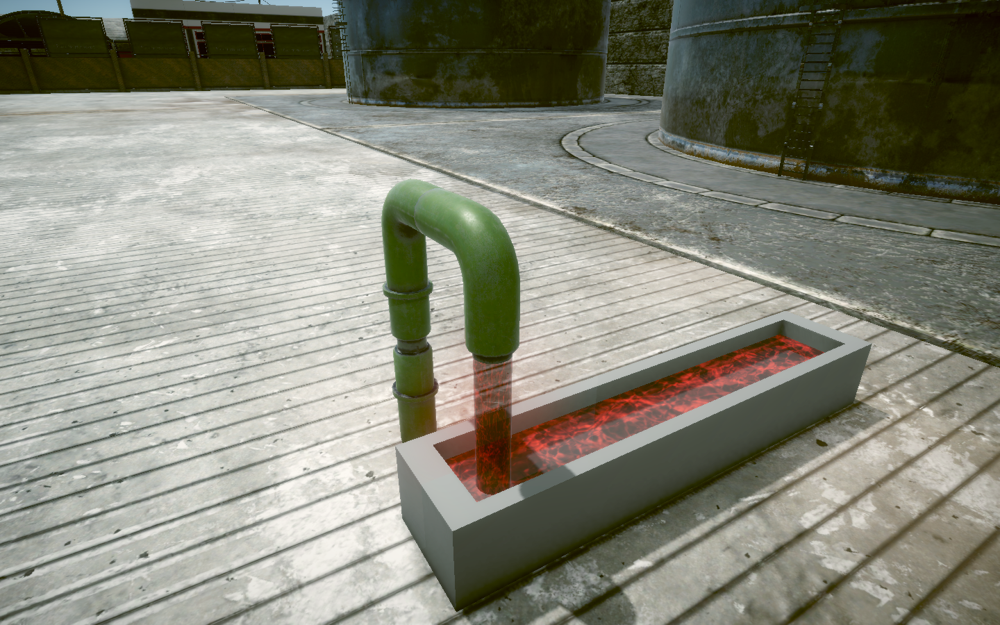

# 04주차 과제 제출 — 느리게 흐르는 빨간 물

**황승경_202202842** · VFX 수업 · `W04` 브랜치

파이프에서 빨간 물이 천천히 흘러내리고, 수조의 수면과 주변 물안개가 함께 움직이는 Unity 이펙트입니다. 흐르는 속도는 수업의 기본 물 효과 대비 **0.35배**입니다.

## 프로젝트 열기

1. 이 저장소의 `W04` 브랜치를 내려받습니다.
2. Unity Hub에 프로젝트 폴더를 추가하고 **Unity 6000.3.23f1**로 엽니다.
3. 에셋 가져오기가 끝나면 `Assets/W04_HW/W04_HW.unity` 씬을 엽니다.
4. 재생 버튼을 눌러 물줄기와 수면이 천천히 움직이는 것을 확인합니다.

## 작업 내용

- 파이프 물줄기, 수조 수면, 물안개에 빨간색 전용 재질을 적용했습니다.
- 물줄기·수면·물안개의 흐름을 기본 대비 0.35배로 늦췄습니다.
- 원본 물 텍스처의 채도를 제거한 뒤 빨간색을 곱해 물결 무늬와 밝기는 살렸습니다.
- 수조와 파이프, 주변 수업용 환경은 유지했습니다.

## 주요 파일과 조절 방법

| 위치 | 내용 |
| --- | --- |
| `Assets/W04_HW/W04_HW.unity` | 빨간 물 과제 제출 씬 |
| `Assets/W04_HW/Red_Slow/` | 빨간 물 전용 재질 3개와 셰이더 그래프 3개 |
| `Assets/W04_IntroductionToShader/W04_IntroductionToShader_Start.unity` | 기본 물 이펙트 작업 씬 |

씬의 `W04.Environment > Pipe` 아래에서 `Water_Fall`, `Water_Puddle`, `Water_Steam`을 확인할 수 있습니다. 각 빨간 물 재질의 **Water Tint**로 색을, **Flow Multiplier**로 속도를 조절합니다. 현재 속도는 `0.35`이며, 물줄기의 **Water Alpha**는 `0.72`입니다.

## 수업 자료

[KNU VFX 2026Q3 수업 저장소](https://github.com/EDU-KNU-VFX-2026Q3/KNU_VFX_2026Q3)의 W04 프로젝트를 기반으로 작업했습니다. 환경 모델과 기존 셰이더 등 수업 제공 에셋의 권리는 원저작자에게 있습니다.
